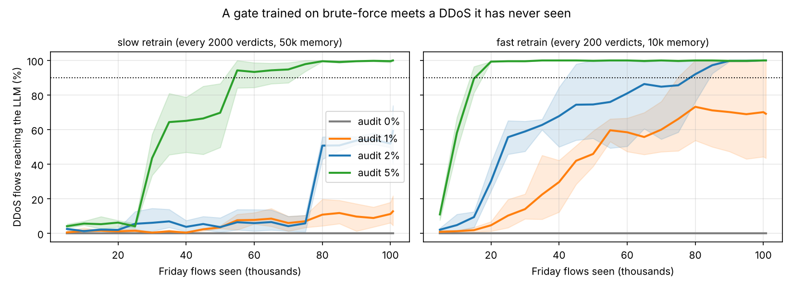

# loggate


**A self-training gate that decides which security events are worth an LLM's attention - and how long it stays blind to an attack it has never seen.**

> **TL;DR** - On real network traffic, a gate that learns only from the LLM's own verdicts cuts LLM calls by ~90% at 99% recall on known attacks. Against an attack class it has never seen, it is **permanently blind unless it randomly audits what it drops**; a 5% audit restores 90% detection within ~17k flows. The audit rate is a product dial with a price on each side.

Security teams are adopting LLMs to triage alerts and explain incidents. An
LLM reads one event well; it cannot read the hundreds of thousands a network
produces per day, and at per-call pricing nobody wants it to. `loggate` puts a
cheap local classifier in front of the LLM and lets it learn **from the LLM's
own verdicts** what routine traffic looks like, so it can stop forwarding it.
No human labels, no offline training: the gate forwards everything at first
and takes over the traffic as it learns.

```
event ──► Gate (one dot product) ──[suspicious?]──► LLM (expensive)
             ▲                                          │
             └──────── learns from every verdict ◄──────┘
```

Two questions, two datasets:

1. **How much does it save?** On 575k HDFS log sessions the gate ends up
   forwarding **4.0%** of traffic while **99.6%** of anomalies still reach the LLM.
2. **What happens when a *new kind* of attack arrives?** On CICIDS2017 network
   traffic a gate trained during password brute-force attacks meets a DDoS it
   has never seen. Without a random audit it **never** catches it. The audit
   rate is the dial: with fast retraining and a **5% audit**, 90% of DDoS flows reach the LLM after
   **~17k Friday flows** (15-20k over 3 seeds), at a routine cost of 11% of traffic.



## How it works

The gate is logistic regression over a feature vector - event-type counts for
log sessions, CICFlowMeter flow statistics for network traffic. Scoring is one
dot product, which is the point of a *cheap* gate.

The forwarding policy is three rules, in order:

1. **Warm-up.** The first `warmup` events are forwarded unconditionally.
2. **Threshold.** Forward if `p(attack) > threshold`.
3. **Random audit.** Forward a random `explore` fraction of what would have
   been dropped. A dropped event never gets a verdict, so without the audit
   the gate can only learn from what it already forwards. Ops teams do this by
   hand; here it is a parameter.

Every verdict goes into a sliding buffer of the last `buffer_max` verdicts;
every `retrain_every` verdicts the classifier is refit with
`class_weight="balanced"`. For network flows, whose features span ten orders
of magnitude, standardization is applied at fit time and folded back into the
weights, so scoring stays one dot product on raw features.

The LLM is **simulated**: it returns the ground-truth label, optionally with a
configurable miss rate and false-alarm rate, which keeps 575k "LLM calls"
reproducible and free. Swapping in a real model is a one-class change
(`loggate/oracle.py`).

## Result 1 - an attack the gate has never seen (CICIDS2017)

CICIDS2017 recorded a week of traffic on a small corporate network while a
red team ran real attacks. We replay two days in order:

| phase | traffic | attack | share |
|---|---|---|---:|
| Tuesday | 446k flows | FTP / SSH password brute-force | 3.1% |
| Friday afternoon | 101k flows | DDoS - absent from Tuesday | 3.0% (subsampled, see below) |

Destination port is **excluded** from the features: every Tuesday attack hits
port 21 or 22, and a gate that learns "port 22 = attack" has learned a shortcut,
not behaviour. Flow statistics are signed-log transformed. Friday is 57% DDoS
in the raw capture because the red team ran a flood; we subsample DDoS to 3%
so the gate faces the base rate it would see in real life.

Mean over 3 seeds. *Routine cost* is the share of Tuesday traffic forwarded
after the gate has learned; *time to detect* is how much Friday traffic passes
before 90% of DDoS flows reach the LLM.

| retraining | audit | routine cost (Tue) | brute-force caught | Friday cost | DDoS ≥ 90% caught after |
|---|---:|---:|---:|---:|---|
| slow | 0% | 5.4% | 99.4% | 1.0% | never |
| slow | 1% | 6.5% | 99.4% | 2.5% | never |
| slow | 2% | 7.6% | 99.4% | 3.9% | never |
| slow | 5% | 10.5% | 99.4% | 8.7% | 62k (55-75k) Friday flows |
| fast | 0% | 2.6% | 78.4% | 0.1% | never |
| fast | 1% | 6.7% | 99.4% | 4.0% | never in 2 of 3 seeds (75k in the third) |
| fast | 2% | 7.9% | 99.4% | 5.9% | 63k (45-85k) Friday flows |
| fast | 5% | 11.0% | 99.5% | 9.5% | **17k (15-20k) Friday flows** |

*Slow* = refit every 2 000 verdicts on the last 50 000; *fast* = every 200 on the last 10 000. Ranges are min-max over seeds.

Three things to read off this table:

* **No audit means permanent blindness.** The gate learned Tuesday's attacks
  perfectly and forwards ~1% of Friday - all of it benign. DDoS flows never
  score above threshold, never get a verdict, and the gate never finds out.
* **The audit rate buys detection time.** With fast retraining, going from a 2% to a 5% audit
  costs 3 more points of routine traffic and cuts time-to-detect from ~63k
  to ~17k flows. At 1% the gate usually never gets there within the day.
* **Fast retraining without an audit is worse than slow.** With no audit, the fast gate catches only 78% of
  the *known* brute-force attacks (vs 99% for the slow gate) and forwards
  0.06% of Friday.
  A gate that only sees what it already chose to forward narrows its own view
  of the world - the selection-bias loop the audit exists to break.

For a product this is one dial with a price on each side: audit traffic costs
LLM calls every day; a longer time-to-detect costs whatever a day of undetected
DDoS costs. Neither number is in this repo; the trade-off curve is.

## Result 2 - how much it saves at scale (HDFS)

575 059 real HDFS log sessions (2.93% anomalous), replayed as one shuffled
stream. Steady state, seed 0:

| threshold | sessions forwarded | anomalies reaching LLM |
|----------:|-------------------:|-----------------------:|
| 0.5 | 3.93% | 98.27% |
| 0.2 (default) | 4.00% | 99.63% |
| 0.02 | 4.11% | 99.93% |


The gate goes from forwarding everything to ~4% within the first 10k sessions
and stays on the anomaly-rate floor for the remaining 565k.

**What if the LLM is wrong?** Misses are cheap, false alarms are fatal:

| LLM behaviour | sessions forwarded | anomalies reaching LLM |
|---------------|-------------------:|-----------------------:|
| perfect LLM | 4.00% | 99.63% |
| misses 20% of anomalies | 4.05% | 99.77% |
| misses 40% of anomalies | 3.90% | 94.20% |
| false-alarms on 1% of normals | 4.04% | 99.87% |
| false-alarms on 5% of normals | 100.00% | 100.00% |

An LLM that overlooks 20% of anomalies just gives the gate fewer positive
examples. An LLM that false-alarms on 5% of normals breaks the gate - and it
has to: at a 2.9% base rate, 5% false alarms produce *more* wrong "anomaly"
labels than there are real anomalies. A teacher's precision on the rare class
matters far more than its overall accuracy.

Full tables (threshold sweep, robustness, ablations): `results/*.csv`.

## What is and isn't new here

The building blocks are well known. A cheap model in front of an expensive one
is a *cascade*; the random audit is *exploration*; a learner that only sees the
cases it chose to inspect suffers from *selective labels*. None of that is
original to this repo. What this repo adds is the application and the
measurement: using the LLM's verdicts as the only training signal for a
security triage gate, and quantifying how long such a gate stays blind to a
new attack class as a function of the audit rate, on real attack traffic.
The numbers in the table above are the contribution; the algorithm is not.

## Honest caveats

* **The LLM is simulated.** Its error modes are parameters, not measurements.
* **Lab data.** CICIDS2017 is a testbed capture, not a customer network; HDFS
  anomalies are system faults, not attacks, and are nearly linearly separable.
  The contribution is the cascade - learning from the expensive stage, the
  audit loop, and the time-to-detect framing - not the classifier.
* **Two attack classes.** "Never seen" is tested on one transition
  (brute-force → DDoS). Other transitions may behave differently.
* **Recall is "reached the LLM".** The gate's job is to make sure the LLM sees
  attacks, not to diagnose them.

## Run it

```bash
pip install -e ".[dev]"
pytest                                   # 19 tests, no data needed

scripts/get_data.sh                      # HDFS sessions, ~30 MB
python scripts/run_experiments.py        # Result 2, ~10 min

# Result 1: download MachineLearningCSV.zip from
# https://www.unb.ca/cic/datasets/ids-2017.html and put these two files in data/cicids2017/:
#   Tuesday-WorkingHours.pcap_ISCX.csv   Friday-WorkingHours-Afternoon-DDos.pcap_ISCX.csv
python scripts/run_security.py           # 8 configs x 3 seeds, ~1 h on 2 cores; resumable
```

```python
from loggate import Gate, GateConfig, SimulatedLLM, Cascade
from loggate.cicids import load_phases

tuesday, friday = load_phases("data/cicids2017")
cascade = Cascade(Gate(GateConfig(explore=0.05, standardize=True)), SimulatedLLM())
for flow in tuesday + friday:
    forwarded, reason = cascade.step(flow)   # reason ∈ {warmup, suspicious, audit, dropped}
```

## Layout

```
loggate/
  gate.py       classifier + forwarding policy (warm-up / threshold / audit)
  cascade.py    run a stream through gate + LLM, record per-window stats
  oracle.py     simulated LLM with miss and false-alarm rates
  data.py       HDFS sessions as a labelled, shuffled stream
  features.py   log session → count vector
  cicids.py     CICIDS2017 flows → features; Tuesday / Friday phases
scripts/        get_data.sh, run_experiments.py (HDFS), run_security.py (CICIDS)
tests/          pytest, no data needed
results/        CSVs and plots from the full runs
```

## Author's note

Built with AI assistance (Claude). The problem framing, experimental design,
decisions along the way and the analysis are mine; the AI helped write and
debug the code and run the experiments. I'm a CS and entrepreneurship student
at Reichman University and happy to talk about any of it.

## Data

* CICIDS2017, Canadian Institute for Cybersecurity, University of New Brunswick
  ([unb.ca/cic/datasets/ids-2017](https://www.unb.ca/cic/datasets/ids-2017.html)).
  Not redistributed here; download requires a name and e-mail.
* HDFS sessions preprocessed by the DeepLog authors
  ([wuyifan18/DeepLog](https://github.com/wuyifan18/DeepLog)) from Loghub
  ([logpai/loghub](https://github.com/logpai/loghub)).
