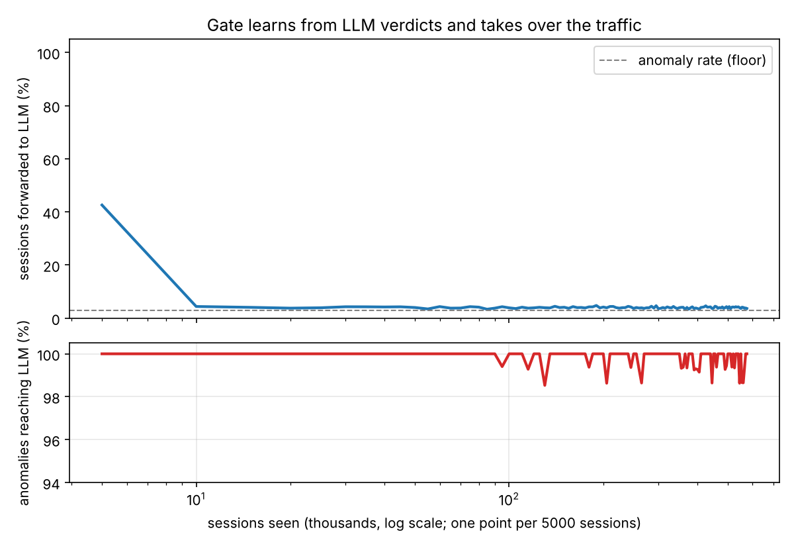
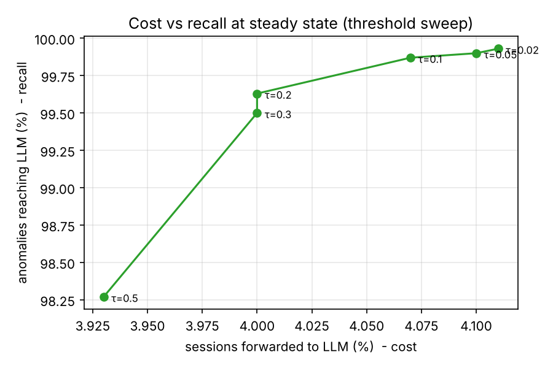

# loggate

**A self-training gatekeeper that decides which log sessions are worth an LLM's attention.**

LLMs are good at reading a log session and explaining what went wrong. They are
also far too expensive to run on every session a cluster produces, when ~97% of
those sessions are routine. `loggate` puts a cheap, local classifier in front
of the LLM and lets it learn **from the LLM's own verdicts** which sessions are
routine, so it can stop forwarding them. No human labels, no offline training
phase: the gate starts out forwarding everything and takes over the traffic as
it learns.

```
log session ──► Gate (one dot product) ──[suspicious?]──► LLM (expensive)
                   ▲                                          │
                   └──────── learns from every verdict ◄──────┘
```

On the HDFS benchmark (575 059 real sessions, 2.9% anomalous) the gate ends up
forwarding **4.0% of sessions** while **99.6% of anomalies
still reach the LLM** - a 25× reduction in LLM calls, learned on the fly.



## How it works

Each session is turned into a vector of event-type counts (log-scaled) plus
its length. The gate is logistic regression on that vector: scoring a session
is one dot product, which is the whole point of a *cheap* gate.

The forwarding policy is three rules, in order:

1. **Warm-up.** The first `warmup` sessions are forwarded unconditionally -
   the gate knows nothing yet.
2. **Threshold.** Forward if `p(anomaly) > threshold`. This is the cost/recall
   dial.
3. **Random audit.** Forward a random `explore` fraction of what would have
   been dropped. A dropped session never gets a verdict, so without this the
   gate could never discover it is wrongly dropping some kind of anomaly. Ops
   teams already do this by hand; here it costs ~1% of traffic.

Every verdict goes into a buffer, and every `retrain_every` verdicts the
classifier is refit on the whole buffer (`class_weight="balanced"`, because
anomalies are a small minority of what the gate sees).

The LLM is **simulated**: it returns the ground-truth label, optionally with a
configurable miss rate and false-alarm rate. That keeps 575k "LLM calls"
reproducible and free. Swapping in a real model is a one-class change
(`loggate/oracle.py`).

## Results

All numbers are steady state (after the gate has learned), on the full stream,
seed 0. Reproduce with `python scripts/run_experiments.py` (a few minutes).

### Cost vs recall - the threshold dial

| threshold | sessions forwarded | anomalies reaching LLM |
|----------:|-------------------:|-----------------------:|
| 0.5 | 3.93% | 98.27% |
| 0.3 | 4.00% | 99.50% |
| 0.2 | 4.00% | 99.63% |
| 0.1 | 4.07% | 99.87% |
| 0.05 | 4.10% | 99.90% |
| 0.02 | 4.11% | 99.93% |

The anomaly rate is 2.93%, so ~4% forwarding is close to the floor; the gap is
the 1% random audit plus false alarms. Note how little the dial moves: going
from τ=0.5 to τ=0.02 costs 0.18 points of traffic and buys 1.7 points of
recall. The classifier is confident enough that a low threshold is nearly
free, so the default (0.2) errs on the side of recall.



### Robustness - what if the LLM is wrong?

| LLM behaviour | sessions forwarded | anomalies reaching LLM |
|---------------|-------------------:|-----------------------:|
| perfect LLM | 4.00% | 99.63% |
| LLM misses 10% of anomalies | 4.03% | 99.77% |
| LLM misses 20% of anomalies | 4.05% | 99.77% |
| LLM misses 40% of anomalies | 3.90% | 94.20% |
| LLM false-alarms on 1% of normals | 4.04% | 99.87% |
| LLM false-alarms on 5% of normals | 100.00% | 100.00% |
| frozen after first fit | 4.32% | 100.00% |
| no random audit (explore=0) | 3.04% | 99.37% |

The asymmetry is the interesting part. **Misses are cheap, false alarms are
fatal.** An LLM that overlooks 20% of anomalies just gives the gate fewer
positive examples, and the gate barely notices. An LLM that false-alarms on 5%
of normals breaks the gate completely - and it has to: at a 2.9% base rate, a
5% false-alarm rate produces *more* wrong "anomaly" labels than there are real
anomalies, so most of what the gate is told is an anomaly isn't one. This is a
base-rate fact, not a modelling choice: a teacher's precision on the rare class
matters far more than its overall accuracy.

Two ablations. Freezing the gate after its first fit (2 000 verdicts) still
works - a bit more conservative (4.32% forwarded) because it was fit on less
data; this stream is shuffled, so there is no drift for continual retraining
to track. Disabling the random audit saves its ~1% of traffic but recall drops
from 99.63% to 99.37%: even with no drift, the gate benefits from occasionally
seeing what it would have dropped.

## Honest caveats

* **HDFS anomalies are easy.** Count features separate them almost linearly
  (supervised logistic regression gets F1 ≈ 0.96 in the literature). The
  contribution here is not the classifier; it is the cascade: learning the gate
  from the expensive stage's verdicts, the audit loop, and the cost/recall
  framing.
* **The LLM is simulated.** Its error modes are parameters, not measurements.
* **The stream is shuffled.** Real logs drift; the audit and periodic retrain
  are designed for that, but it is not demonstrated here.
* **Recall is "reached the LLM".** The gate's job is to make sure the LLM sees
  anomalies, not to diagnose them.

## Run it

```bash
pip install -e ".[dev]"
scripts/get_data.sh                  # ~30 MB, HDFS sessions in DeepLog format
python scripts/run_experiments.py    # writes results/*.csv and *.png
pytest
```

```python
from loggate import Gate, GateConfig, SimulatedLLM, Cascade
from loggate.data import load_stream

cascade = Cascade(Gate(GateConfig(threshold=0.2)), SimulatedLLM())
for ex in load_stream("data", limit=50_000):
    forwarded, reason = cascade.step(ex)     # reason ∈ {warmup, suspicious, audit, dropped}
```

## Layout

```
loggate/
  data.py       load HDFS sessions as a labelled, shuffled stream
  features.py   session → count vector (log1p) + log length
  gate.py       classifier + forwarding policy (warm-up / threshold / audit)
  oracle.py     simulated LLM with miss and false-alarm rates
  cascade.py    run a stream through gate + LLM, record per-window stats
scripts/        get_data.sh, run_experiments.py
tests/          pytest, no data needed
results/        CSVs and plots from the full run
```

## Data

HDFS sessions preprocessed by the DeepLog authors
([wuyifan18/DeepLog](https://github.com/wuyifan18/DeepLog)) from the Loghub
HDFS_v1 dataset ([logpai/loghub](https://github.com/logpai/loghub)). DeepLog's
train/test split is not used: everything is merged into one labelled stream.
